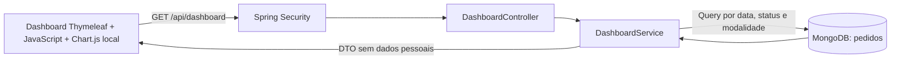
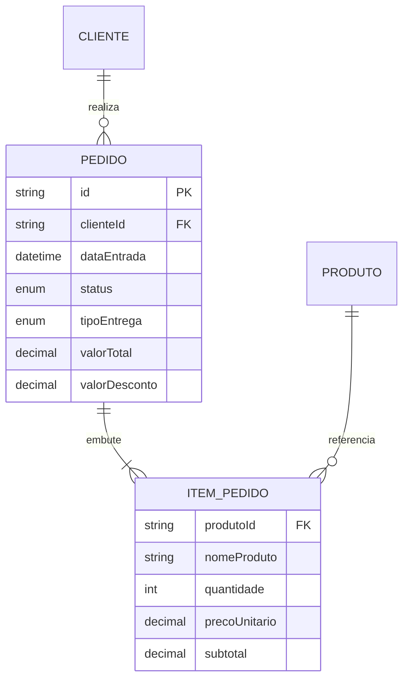

# Dashboard Administrativo — Pediu Patrão

## Contexto e objetivo

Evolução do sistema existente de lanchonete/pizzaria para apoiar o responsável pelo estabelecimento na leitura do desempenho de vendas, acompanhamento de pedidos e identificação dos produtos mais vendidos. A solução mantém Java 21, Spring Boot 3.4, Spring Security, Thymeleaf e MongoDB.

## Requisitos funcionais e critérios de aceitação

| ID | Requisito | Critério de aceitação |
|---|---|---|
| RF01 | Indicadores gerais de vendas | Exibir faturamento, quantidade total de pedidos, finalizados, em andamento, ticket médio, descontos, cancelados e taxa de cancelamento. |
| RF02 | Análise gráfica | Gráfico de linha por dia ou mês, preenchendo intervalos sem vendas com zero; gráfico de rosca por situação; tabela alternativa aos dados da linha. |
| RF03 | Situação dos pedidos | Mostrar todos os estados, inclusive contagens zero, e pedidos recentes com data, modalidade, situação e valor. |
| RF04 | Produtos mais vendidos | Ordenar por unidades vendidas em pedidos finalizados, exibir quantidade e valor bruto; top 5 na interface, até 20 na API. |
| RF05 | Filtros de consulta | Início, fim, situação, entrega/retirada e agrupamento diário/mensal; todos os componentes respeitam os mesmos filtros. |
| RF06 | Integração com API | Consultar JSON de `/api/dashboard` e carregar opções de `/api/dashboard/filtros`, com sessão autenticada. Nenhum número de demonstração é fixado no frontend. |
| RF07 | Atualização e tratamento | Atualização manual e automática a cada 60 segundos quando a aba está visível; indicar carregamento, última atualização, consulta vazia, erro e sessão expirada. |
| RF08 | Acesso administrativo | Somente ADMIN e GERENTE acessam página, consultas e serviço; ATENDENTE recebe 403. |
| RF09 | Paginação | Pedidos recentes ordenados por entrada e id decrescentes, páginas de 10 itens. |

## Requisitos não funcionais

| ID | Requisito e verificação |
|---|---|
| RNF01 | Segurança: autenticação de sessão existente, autorização no filtro e anotações; GET de leitura, demais métodos negados; CSRF mantido nas escritas do sistema. Testes de 401 e 403. |
| RNF02 | Precisão: BigDecimal no cálculo monetário, duas casas e arredondamento HALF_UP; divisão por zero retorna 0.00. |
| RNF03 | Eficiência: filtro temporal indexado no MongoDB, projeção de campos, janela máxima de 366 dias e ranking limitado. A consolidação usa memória proporcional aos pedidos do período: adequada à atividade e pequenos estabelecimentos; grandes volumes exigem agregações MongoDB e paginação no banco. Não há garantia de latência sem teste de carga. |
| RNF04 | Usabilidade: layout responsivo, filtros rotulados, foco de teclado, mensagens em português, formatação monetária brasileira e dados tabulares alternativos. |
| RNF05 | Confiabilidade: respostas 400/422 para parâmetros inválidos, 503 para indisponibilidade do banco, dados anteriores preservados com aviso quando a atualização falha; timeout de 20 s no cliente. |
| RNF06 | Manutenibilidade: separação controller/service/DTO, testes de cálculo, HTTP, autorização e integração real com MongoDB; CI no GitHub Actions. |
| RNF07 | Privacidade: API do painel não expõe nome, telefone, endereço ou credenciais dos clientes. |
| RNF08 | Portabilidade: JDK 21 e Maven Wrapper; MongoDB local/Atlas; compose opcional e perfil demo isolado. |

## Regras de negócio

1. **Faturamento realizado:** soma de `valorTotal` de pedidos atualmente FINALIZADO, já descontados. Não representa comprovantes de pagamento; o sistema não tem módulo financeiro de recebimentos.
2. **Ticket médio:** faturamento dividido pelo número de finalizados. Sem finalizados: zero.
3. **Descontos:** soma de `valorDesconto` dos finalizados. Valores brutos do ranking vêm dos subtotais dos itens, sem rateio dos descontos.
4. **Cancelamento:** cancelados / total filtrado × 100. Filtrar somente CANCELADO resulta em taxa de 100% e faturamento zero.
5. **Período:** usa `dataEntrada`, começo inclusivo à meia-noite e fim inclusivo implementado como menor que o início do dia seguinte. O painel mostra a situação atual dos pedidos desse período, e não uma reconstrução histórica de status.
6. **Fuso:** datas padrão e relógio do painel usam America/Sao_Paulo. O modelo legado armazena LocalDateTime; executar JVM no mesmo fuso dos dados originais (São Paulo no ambiente validado). Mudança de fuso em produção exige migração explícita para Instant, para não reinterpretar registros antigos.
7. **Legado:** pedidos sem dataEntrada não entram na janela temporal; sem status aparecem como SEM_STATUS e em andamento. Valores nulos viram zero; itens ausentes ou sem produtoId válido ficam fora do ranking. Não se inventam preços para pedidos antigos.
8. **Ranking:** quantidade descendente e produtoId como desempate determinístico; nomes/preços preservados no item do pedido. Se um produto foi renomeado, usa-se o nome da ocorrência mais recente na consulta.

## Arquitetura e modelagem

Não foi criada uma coleção de estatísticas: o painel lê os pedidos persistidos, evitando sincronização duplicada. O índice de data é criado em `MongoInitConfig`. O DTO de resposta separa a representação pública da entidade e omite dados pessoais. Uma consulta consolidada mantém consistência entre os componentes de cada atualização; as opções de filtros têm endpoint separado. A consulta lê o estado presente, sem cache.

## Organização Gitflow

- `main`: versão pronta para entrega.
- `develop`: integração da evolução do projeto.
- `feature/dashboard-administrativo`: implementação da API, interface, testes e documentos, criada a partir de develop.
- Fluxo: feature → develop → main, com merges registrados. A atividade anterior permanece no histórico.

## Rastreabilidade das verificações

- RF01/RF02/RF04: `DashboardServiceTest` verifica somas, descontos, ranking, agrupamento e períodos vazios.
- RF03/RF05/RF09: testes de situação, paginação e filtros; `DashboardMongoIntegrationTest` verifica consulta real, limites de data e filtros combinados.
- RF06/RF08: `DashboardApiTest` verifica autenticação, permissões, parâmetros e renderização do template.
- RF07: testes de 400/422/503; verificações visuais e temporizador no navegador devem ser conferidos ao preparar o vídeo. Resultados efetivamente obtidos estão em [TESTES.md](TESTES.md).
